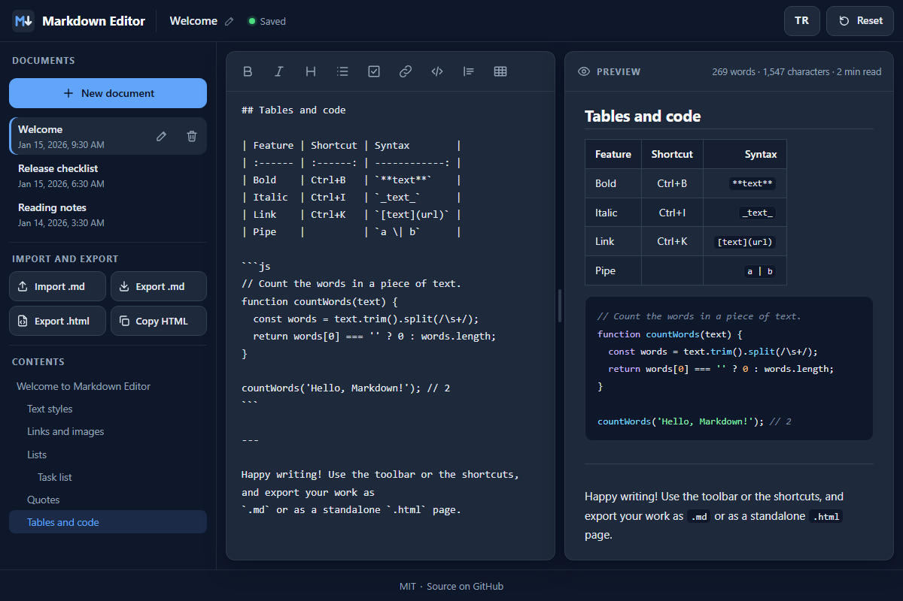

# Markdown Editor - a fast, private Markdown editor with live preview that runs entirely in your browser

[](https://github.com/celaldrg/markdown-editor/actions/workflows/test.yml)
[](LICENSE)

**▶ Open the app: https://celaldrg.github.io/markdown-editor/**



Write Markdown and watch it render as you type. There is no account, no server and no tracking: your documents are saved in your own browser. The Markdown parser is written from scratch for this project, so the app has no dependencies and makes no network requests.

## Features

- **Split view with synchronized scrolling** - a monospace editor and a live preview that follow each other while you scroll. Drag the divider to resize them.
- **Its own Markdown parser** - headings, bold, italic, strikethrough, inline code, fenced code blocks, block quotes, nested and numbered lists, task lists, tables with column alignment, links, images and horizontal rules.
- **Syntax highlighting** in code blocks for JavaScript / TypeScript, JSON, C-style languages (C, C++, C#, Java, Go, Rust and more), Python, shell and CSS.
- **Safe preview** - the preview is built from DOM nodes, never from HTML strings. Raw HTML is shown as text and links only accept http, https, mailto and relative addresses.
- **Formatting toolbar** with 9 actions: bold, italic, heading, bulleted list, task list, link, code, quote and table.
- **Smart editing** - Tab indents with two spaces, Enter continues lists and quotes, and an empty item ends the list.
- **Autosave** with a status in the header (Saved / Saving).
- **Several documents** - create, rename, delete and switch between them.
- **Table of contents** built from your headings. Click an entry to jump to it; the current section is highlighted.
- **Task lists you can tick** right in the preview.
- **Import and export** - open `.md` files (button or drag and drop), download `.md` or a standalone `.html` page, or copy the HTML.
- **Word, character and reading-time counts.**
- **English and Turkish interface**; your choice is remembered.
- **Made for phones too** - Edit / Preview tabs, a slide-in drawer and large tap targets. Honors the reduced-motion setting.
- A sample document that shows every feature, in English or Turkish: a first visit and **Reset** use the interface language. `?demo` opens a fixed demo state (used for the screenshot).

## How to use

**Keyboard**

| Keys | Action |
| --- | --- |
| Ctrl/Cmd + B, Ctrl/Cmd + I, Ctrl/Cmd + K | Bold, italic, link |
| Tab / Shift + Tab | Indent / outdent (two spaces) |
| Enter | Continue the list or quote; on an empty item, end it |
| Esc, then Tab | Leave the editor (Tab alone indents) |
| Ctrl/Cmd + S | Save now |
| Left / Right arrow, Home, End | Move between toolbar buttons |
| Left / Right arrow, Home, End, Enter (on the divider) | Resize the panes, reset with Enter |
| Esc | Close the menu or a dialog |

**Mouse and touch**

- Toolbar buttons format the selected text or the current line. Bold, italic, lists, quote and code come off again with a second click; heading steps through levels 1 to 3.
- Click the document title in the header to rename it.
- Drag the divider between the editor and the preview to resize them; double-click it to reset.
- On a phone, switch between **Edit** and **Preview** with the tabs, and open the menu button for your documents, import / export and the table of contents. Tap outside the menu to close it.
- Drop a `.md` file anywhere on the page to import it.
- **Reset** deletes all documents and brings back the sample (after a confirmation).

## Run locally

```sh
npx serve .
```

Then open the address it prints (for example http://localhost:3000). The app uses ES modules, so it has to be served over http://; opening `index.html` directly as a file:// page does not work. There is no build step.

## Tests

```sh
node --test
```

Uses the built-in Node.js test runner (Node 22 or newer) and needs no install. The tests cover the parser (including a list of XSS attacks), the HTML renderer, editor operations, documents and storage, export, translations, static checks of the page and a code hygiene scan.

For a coverage report:

```sh
node --test --experimental-test-coverage
```

## Project structure

```text
index.html         page markup
style.css          styles (dark theme, responsive)
src/
  main.js          entry point
  app.js           connects the views to the logic
  *-view.js        UI modules: editor, preview, sidebar, layout, scrolling
  parser.js        Markdown to syntax tree (block-parser.js, inline-parser.js)
  render.js        syntax tree to HTML / DOM
  editor-ops.js    toolbar actions, indenting, list continuation (pure)
  workspace.js     documents, autosave state (pure)
  storage.js       the only module that touches localStorage
  i18n.js          English and Turkish strings
test/              node:test suites and fixtures
docs/              screenshot
```

## License

[MIT](LICENSE) © 2026 Celalettin Durgaç

## Türkçe

Tarayıcıda çalışan hızlı ve gizli bir Markdown düzenleyici: siz yazdıkça canlı önizleme güncellenir. Hesap, sunucu ya da takip yoktur; belgeler kendi tarayıcınızda saklanır. Markdown ayrıştırıcısı bu proje için sıfırdan yazıldı; uygulamanın bağımlılığı yoktur ve ağa istek göndermez.

**▶ Uygulamayı aç: https://celaldrg.github.io/markdown-editor/**

### Özellikler

- **Eşzamanlı kaydırmalı bölünmüş görünüm** - eş genişlikli yazı tipli düzenleyici ve canlı önizleme birlikte kayar; aradaki ayırıcıyı sürükleyerek boyutlandırılır.
- **Kendi Markdown ayrıştırıcısı** - başlıklar, kalın, italik, üstü çizili, satır içi kod, kod blokları, alıntılar, iç içe ve numaralı listeler, görev listeleri, hizalamalı tablolar, bağlantılar, görseller ve yatay çizgiler.
- Kod bloklarında **söz dizimi renklendirme** (JavaScript / TypeScript, JSON, C ailesi, Python, kabuk, CSS).
- **Güvenli önizleme** - önizleme HTML metninden değil, DOM düğümlerinden kurulur; ham HTML metin olarak gösterilir, bağlantılarda yalnız http, https, mailto ve göreli adresler kabul edilir.
- 9 düğmeli **biçim araç çubuğu**: kalın, italik, başlık, madde listesi, görev listesi, bağlantı, kod, alıntı, tablo.
- **Otomatik kayıt** ve üst çubukta kayıt durumu.
- **Birden çok belge** - oluşturma, yeniden adlandırma, silme ve belgeler arasında geçiş.
- Başlıklardan oluşan **içindekiler**; tıklayınca ilgili yere gider, bulunduğunuz bölüm vurgulanır.
- Önizlemede işaretlenebilen **görev listeleri**.
- **İçe ve dışa aktarma** - `.md` dosyası açma (düğme ya da sürükle-bırak), `.md` ya da tek başına çalışan `.html` indirme, HTML'i panoya kopyalama.
- Kelime, karakter ve okuma süresi sayaçları; **Türkçe ve İngilizce arayüz**.
- **Telefona uygun**: Düzenle / Önizleme sekmeleri, kayan menü, büyük dokunma alanları; azaltılmış hareket ayarına uyar.
- Tüm özellikleri gösteren İngilizce ya da Türkçe örnek belge: ilk ziyarette ve **Sıfırla** sonrasında arayüz dilinde açılır. `?demo` sabit bir tanıtım durumu açar (ekran görüntüsü için).

### Nasıl kullanılır

- **Klavye:** Ctrl/Cmd + B kalın, Ctrl/Cmd + I italik, Ctrl/Cmd + K bağlantı; Tab / Shift + Tab girinti (iki boşluk); Enter listeyi sürdürür, boş maddede listeyi bitirir; Esc ardından Tab düzenleyiciden çıkar; Ctrl/Cmd + S hemen kaydeder; araç çubuğunda ve ayırıcıda sol / sağ ok, Home, End; Esc menüyü ya da pencereyi kapatır.
- **Fare ve dokunma:** araç çubuğu düğmeleri seçili metni ya da bulunduğunuz satırı biçimlendirir (kalın, italik, liste, alıntı ve kodda ikinci tıklama biçimi kaldırır, başlık 1-3 düzeyleri arasında döner); üst çubuktaki belge adına tıklayınca yeniden adlandırılır; ayırıcı sürüklenir, çift tıklayınca sıfırlanır. Telefonda **Düzenle** ve **Önizleme** sekmeleriyle geçilir, menü düğmesi belgeleri, içe / dışa aktarmayı ve içindekileri açar. Bir `.md` dosyasını sayfaya bırakmak onu içe aktarır. **Sıfırla** onaydan sonra tüm belgeleri siler ve örnek belgeyi geri getirir.

### Yerelde çalıştırma

```sh
npx serve .
```

Yazdığı adresi açın (ör. http://localhost:3000). Uygulama ES modülleri kullandığı için http:// üzerinden sunulmalıdır; `index.html` dosyasını file:// ile doğrudan açmak çalışmaz. Derleme adımı yoktur.

### Testler

```sh
node --test
node --test --experimental-test-coverage
```

Node.js'in yerleşik test çalıştırıcısı (Node 22 ve üstü) kullanılır, kurulum gerekmez. İkinci komut kapsam raporu verir. Testler ayrıştırıcıyı (bir XSS saldırıları listesi dahil), HTML çıktısını, düzenleyici işlemlerini, belgeleri ve kaydı, dışa aktarmayı, çevirileri, sayfanın statik kontrollerini ve bir kod temizliği taramasını kapsar.

### Lisans

[MIT](LICENSE) © 2026 Celalettin Durgaç
